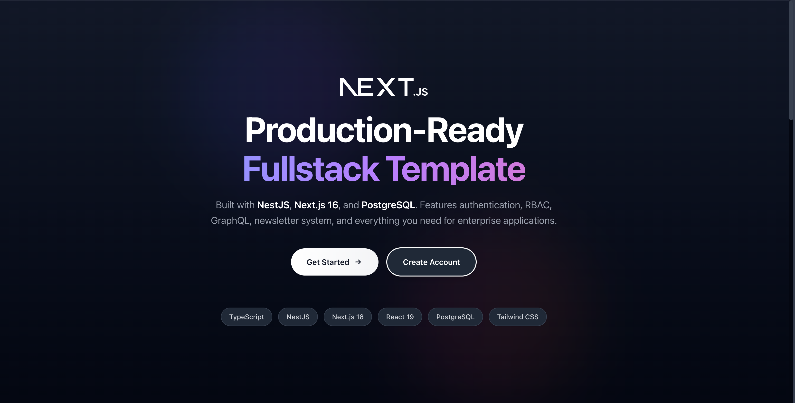
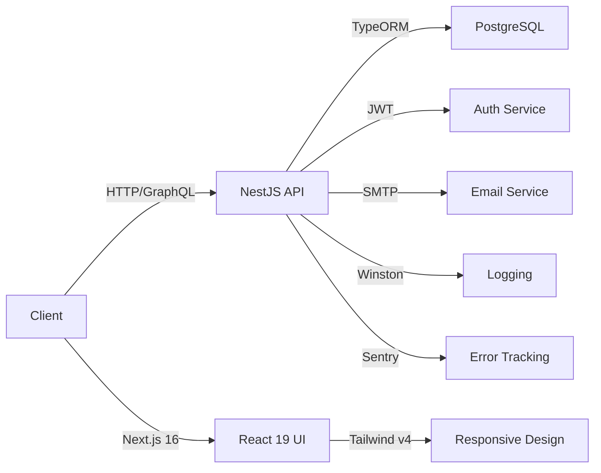

<div align="center">


<br/>
<br/>

# 🚀 Production-Ready Fullstack Template

<p align="center">
  <strong>The Ultimate Enterprise Fullstack Template</strong>
  <br/>
  <em>Built for Scale • Optimized for AI Agents • Production Ready from Day One</em>
</p>

<br/>

<!-- Hero Badges - Modern Tech Stack -->
<p align="center">
  
  
  
  
  
</p>

<p align="center">
  
  
  
  
  
</p>

<br/>

<!-- Repository Stats -->
<p align="center">
  <a href="https://github.com/k-kaundal/fullstack-nnp-template/stargazers">
    
  </a>
  <a href="https://github.com/k-kaundal/fullstack-nnp-template/network/members">
    
  </a>
  <a href="https://github.com/k-kaundal/fullstack-nnp-template/issues">
    
  </a>
  <a href="https://github.com/k-kaundal/fullstack-nnp-template/blob/main/LICENSE">
    
  </a>
</p>

<p align="center">
  
  
  
  
  
  
  
</p>

<p align="center">
  <a href="https://fullstack-nnp-template.vercel.app/" target="_blank">
    
  </a>
</p>

---

<br/>

## 📸 **Preview**

<div align="center">
  

  <br/>
  <br/>

  <p>
    <em>✨ Modern, responsive design with dark/light mode • Professional UI components • Production-ready dashboards</em>
  </p>
</div>

<br/>

---

<br/>

## 🌟 **Why Choose This Template?**

<table>
<tr>
<td width="33%" align="center" valign="top">

### 🤖 **AI-First Development**

<br/>

**The world's first fullstack template built specifically for AI coding agents**

<br/>

🎯 **1000+ lines** of comprehensive AI coding instructions 🔧 **Zero-tolerance**
code quality gates 📋 **Standardized patterns** for consistent AI output 🧪
**Mandatory testing** with 80%+ coverage 📚 **Complete documentation** for every
feature

<br/>

> **Perfect for**: GitHub Copilot, Cursor AI, Claude, GPT-4

</td>
<td width="33%" align="center" valign="top">

### 🏗️ **Production Ready**

<br/>

**Enterprise-grade architecture with battle-tested best practices**

<br/>

🔒 **Security hardened** - XSS, SQL injection, CSRF protection ⚡ **Performance
optimized** - Caching, rate limiting, monitoring ✅ **Quality gates** - ESLint,
Prettier, TypeScript strict mode 🧪 **80%+ test coverage** - Unit, integration,
E2E tests 📈 **Monitoring built-in** - Winston logging, Sentry, request tracking

<br/>

> **Perfect for**: Startups to enterprise applications

</td>
<td width="33%" align="center" valign="top">

### 💻 **Developer Experience**

<br/>

**Modern tooling and beautiful UI for rapid development**

<br/>

🎨 **10+ UI components** - Modal, Table, Sidebar, Forms 🌙 **Beautiful dark
mode** - Persistent theme system 🔥 **Hot reload** - Turbopack & Fast refresh 📦
**Everything configured** - No setup needed 🎭 **100% TypeScript** - Type-safe
throughout

<br/>

> **Perfect for**: Learning, prototyping, shipping fast

</td>
</tr>
</table>

<br/>

## ⚡ **Key Features at a Glance**

<table>
<tr>
<td width="50%" valign="top">

### 🎯 **Backend Excellence**

<br/>

**🏗️ Architecture & Core**

- ✅ **NestJS** - Progressive Node.js framework, modular architecture
- ✅ **PostgreSQL** + **TypeORM** - Migrations, seeders, auto-seeding on startup
- ✅ **TypeScript Strict Mode** - Zero `any` types, 100% type-safe
- ✅ **Monorepo Structure** - Organized for scalability

**🔐 Security & Authentication**

- ✅ **JWT Authentication** - Access (15min) + Refresh tokens (7 days)
- ✅ **RBAC** (Role-Based Access Control) - Dynamic permissions system
- ✅ **Session Management** - Multi-device tracking with IP/user agent
- ✅ **Email Verification** - Crypto-based secure tokens
- ✅ **Password Security** - Bcrypt + strong validation rules
- ✅ **Token Blacklisting** - Server-side logout invalidation
- ✅ **XSS & SQL Injection Protection** - Automatic sanitization
- ✅ **Disposable Email Blocking** - Spam prevention

**🚦 API & Monitoring**

- ✅ **REST API** - Swagger docs with reusable decorators
- ✅ **GraphQL API** - Apollo Server v4, schema-first design
- ✅ **Rate Limiting** - IP & user-based (configurable tiers)
- ✅ **Request Logging** - PostgreSQL-backed with auto-cleanup
- ✅ **API Versioning** - URI & header-based with deprecation headers
- ✅ **Correlation IDs** - Request tracking across services
- ✅ **Winston Logging** - Multiple transports, daily rotation
- ✅ **Sentry Integration** - Error monitoring & performance tracking

**🛠️ Advanced Features**

- ✅ **Error Handling** - 70+ standardized error codes, 40+ exception classes
- ✅ **Caching Layer** - Redis-compatible with auto-invalidation
- ✅ **Email Service** - SMTP with templates
- ✅ **Blog CMS** - Full-featured blog with TipTap editor, categories, tags, SEO
- ✅ **Newsletter System** - Subscription + bulk sending with templates
- ✅ **Contact Form** - Public form with admin management & email notifications
- ✅ **Visitor Analytics** - IP tracking, geolocation, device info, Google
  Analytics-style charts
- ✅ **Request Logging** - HTTP request tracking with performance metrics &
  cleanup
- ✅ **Cron Jobs** - Scheduled cleanup tasks
- ✅ **Data Validation** - 10+ custom decorators (@IsStrongPassword, @NoXss)
- ✅ **Database Migrations** - Complete tooling (generate, run, rollback)

</td>
<td width="50%" valign="top">

### 💎 **Frontend Excellence**

<br/>

**🎨 Modern Stack**

- ✅ **Next.js 16** - App Router + Turbopack for blazing speed
- ✅ **React 19** - Server Components + latest features
- ✅ **Tailwind CSS v4** - Latest syntax with dark mode
- ✅ **TypeScript** - Strict mode, zero `any` types
- ✅ **next-themes** - Persistent theme system

**🔐 Authentication & Security**

- ✅ **JWT Auth Flow** - Automatic token refresh (queue management)
- ✅ **Protected Routes** - Route guards with session validation
- ✅ **Session Persistence** - No logout on page refresh
- ✅ **Multi-tab Sync** - Auth state synchronized across tabs
- ✅ **Storage Utility** - Safe localStorage wrapper

**🎨 UI Components Library**

- ✅ **Modal/Dialog System** - ViewDialog, EditDialog, Confirm
- ✅ **Toast Notifications** - Sonner with promise support
- ✅ **Advanced Tables** - Sorting, pagination, bulk actions, CSV export
- ✅ **Dynamic Sidebar** - RBAC-aware navigation
- ✅ **Form Components** - Real-time validation
- ✅ **Theme Switcher** - Light/dark mode toggle
- ✅ **Loading States** - Spinners, skeletons
- ✅ **Error Boundaries** - Graceful error handling

**📊 Admin Dashboards**

- ✅ **User Management** - Full CRUD, bulk ops, statistics (810 lines)
- ✅ **Blog CMS** - Professional TipTap editor, categories, tags, SEO metadata
- ✅ **Visitor Analytics** - Google Analytics-style dashboard with charts
  (Recharts)
- ✅ **Request Logs** - Performance metrics, cleanup management
- ✅ **Newsletter Admin** - Subscriber management, bulk send
- ✅ **Contact Messages** - Admin dashboard for contact form submissions
- ✅ **Role Management** - RBAC administration
- ✅ **Statistics Cards** - Real-time metrics

**🛠️ Developer Tools**

- ✅ **API Client** - Type-safe with interceptors
- ✅ **Custom Hooks** - useAuth, useUsers, useTheme
- ✅ **Type Guards** - Runtime type checking
- ✅ **ESLint + Prettier** - Zero-tolerance quality gates
- ✅ **Responsive Design** - Mobile-first approach

</td>
</tr>
</table>

<br/>

## 🎯 **What Makes This Special?**

<table>
<tr>
<td width="50%" valign="top">

### 🤖 **Built for AI Coding Agents**

This is **the world's first fullstack template specifically designed for
AI-assisted development**. Unlike other templates that are just code
repositories, this one teaches AI agents how to write production-grade code.

**🎓 Comprehensive AI Instructions:**

- 📋 **1000+ lines** of detailed coding guidelines in
  `.github/copilot-instructions.md`
- 🎯 **Standardized patterns** for controllers, services, components, and hooks
- ✅ **Zero-tolerance rules** - No `any` types, no console.log, mandatory tests
- 📚 **Complete examples** - Working user module demonstrating all patterns
- 🧪 **Testing standards** - Every controller/service must have .spec.ts tests

**🔧 What AI Agents Get:**

- Clear patterns for consistent code structure
- Type-safe development with proper interfaces
- Standardized error handling with ApiResponse utilities
- Pre-configured testing with patterns and coverage requirements
- UI component library with documented props and examples
- API standards with Swagger documentation

**💡 Supported AI Tools:**

- ✅ GitHub Copilot (optimized)
- ✅ Cursor AI
- ✅ Claude (via Copilot)
- ✅ GPT-4 (via Copilot)
- ✅ Any AI assistant that reads project instructions

> **Result:** AI generates code that passes all quality gates, follows best
> practices, and is production-ready from day one.

</td>
<td width="50%" valign="top">

### 🏆 **Production-Grade Quality**

This template enforces **enterprise-level standards** that most templates skip.

**🚫 Zero-Tolerance Quality Gates:**

- ❌ **No `any` types** - Strict TypeScript throughout
- ❌ **No console.log** - Proper logging only (Winston/Logger)
- ❌ **No window.alert()** - Professional UI components (Modal, Toast)
- ❌ **No ESLint errors** - Must be 0 errors to commit
- ❌ **No failing tests** - 80%+ coverage required
- ❌ **No inline interfaces** - Organized in dedicated folders

**✅ Automated Enforcement:**

- 🎯 **Husky v9** - Git hooks (pre-commit, commit-msg)
- 🔍 **lint-staged** - Auto-fix ESLint + Prettier on commit
- ✅ **commitlint** - Conventional commit format enforced
- 🧪 **Jest** - Tests run automatically
- 📝 **TypeScript checks** - Both server & client validated

**🎨 Professional Features:**

- 📊 **Admin dashboards** - User management (810 lines), request logs,
  newsletter
- 🎨 **10+ UI components** - Production-ready with dark mode
- 📈 **Monitoring** - Winston logs, Sentry, request tracking, performance
  metrics
- 🔒 **Security** - XSS protection, SQL injection prevention, rate limiting
- 📧 **Complete email system** - Verification, password reset, newsletters

> **Result:** Code quality that matches enterprise standards, enforced
> automatically.

</td>
</tr>
</table>

<br/>

## � **Quick Start - Get Running in 5 Minutes**

### 🎯 **Try it Live First!**

👉 **[View Live Demo](https://fullstack-nnp-template.vercel.app/)** - See the
template in action before installing

<details>
<summary>📸 <strong>What you'll see in the live demo</strong></summary>

<br/>

- ✅ **Homepage** with modern design and theme switcher
- ✅ **Admin Dashboard** (Login with demo credentials below)
- ✅ **User Management** with full CRUD operations
- ✅ **Newsletter System** with bulk sending
- ✅ **Role-Based Access Control (RBAC)**
- ✅ **Request Logs Dashboard** with metrics
- ✅ **Dark/Light mode** throughout the app

</details>

<br/>

### Prerequisites

- **Node.js** 22+ (see `.nvmrc`)
- **Yarn** (recommended) or npm
- **PostgreSQL** 14+
- **Git**

### 🎯 **Option 1: Use GitHub Template (Recommended)**

1. **Click "Use this template"** button at the top of this repository
2. **Create your repository** from the template
3. **Clone your new repository**:
   ```bash
   git clone https://github.com/k-kaundal/fullstack-nnp-template.git
   cd fullstack-nnp-template
   ```

### 🎯 **Option 2: Clone Directly**

```bash
git clone https://github.com/k-kaundal/fullstack-nnp-template.git
cd fullstack-nnp-template
```

### ⚡ **One-Command Setup**

```bash
chmod +x setup.sh && ./setup.sh
```

This will:

- ✅ Install all dependencies (client + server)
- ✅ Start PostgreSQL via Docker
- ✅ Create database and run migrations
- ✅ Seed initial data (admin user, roles, permissions)
- ✅ Start both frontend and backend in dev mode

### 🎮 **Manual Setup (Alternative)**

<details>
<summary><b>Click to expand manual setup instructions</b></summary>

<br/>

**1. Install Dependencies**

```bash
# Install root dependencies (Husky, lint-staged, commitlint)
yarn install

# Install server dependencies
cd server && yarn install

# Install client dependencies
cd ../client && yarn install
```

**2. Setup Database**

```bash
# Start PostgreSQL via Docker
docker compose up -d

# Or use your local PostgreSQL and create database
createdb your_database_name
```

**3. Configure Environment**

```bash
# Server configuration
cd server
cp .env.example .env
# Edit .env with your database credentials

# Client configuration
cd ../client
cp .env.local.example .env.local 2>/dev/null || cp .env.example .env.local
# Edit .env.local with your API URL
```

**4. Run Migrations & Seed Data**

```bash
cd server

# Run database migrations
yarn migration:run

# Seed initial data (optional but recommended)
yarn seed
```

**5. Start Development Servers**

```bash
# Terminal 1 - Start backend (http://localhost:3001)
cd server
yarn start:dev

# Terminal 2 - Start frontend (http://localhost:3000)
cd client
yarn dev
```

</details>

### 🎉 **Access the Application**

- **Frontend**: [http://localhost:3000](http://localhost:3000)
- **Backend API**: [http://localhost:3001/api/v1](http://localhost:3001/api/v1)
- **Swagger Docs**: [http://localhost:3001/api](http://localhost:3001/api)
- **GraphQL Playground**:
  [http://localhost:3001/graphql](http://localhost:3001/graphql)

### 🔐 **Default Credentials**

```
Email: admin@example.com
Password: Admin@123
```

> **🎯 Pro Tip:** After setup, check out the
> [User Management Dashboard](http://localhost:3000/admin/users) to see all
> features in action!

<br/>

## �📊 **Tech Stack Overview**



<br/>

## 📦 **What You Get Out of the Box**

### 🎨 **Pre-Built Admin Dashboards**

<table>
<tr>
<td width="50%" valign="top">

#### 👥 **User Management**

**Route:** `/admin/users` | **Lines:** 810

**Features:**

- ✅ Full CRUD operations (Create, Update, Delete)
- ✅ Advanced search & filtering (email, name, status)
- ✅ Statistics cards (Total, Active, Inactive, New)
- ✅ Bulk operations (Activate, Deactivate, Delete)
- ✅ Professional dialogs (View, Edit, Confirm)
- ✅ Sortable table with pagination
- ✅ CSV export functionality
- ✅ Real-time toast notifications
- ✅ Dark mode support

**UI Components Used:**

- Table (sortable, paginated)
- ViewDialog (formatted data display)
- EditDialog (form with validation)
- Confirm (destructive action prompts)
- Toast (success/error feedback)

</td>
<td width="50%" valign="top">

#### 📧 **Newsletter System**

**Route:** `/admin/newsletter` | **Lines:** 540+

**Features:**

- ✅ Subscriber management with search
- ✅ Statistics dashboard
- ✅ Bulk email sending
- ✅ HTML email templates (3 pre-built)
- ✅ Live preview before sending
- ✅ CSV export subscribers
- ✅ Bulk operations (activate, delete)
- ✅ Public subscription form

**Email Templates:**

- Welcome Email (purple gradient)
- Monthly Update (blue header)
- Announcement (red alert style)

</td>
</tr>
<tr>
<td width="50%" valign="top">

#### 📈 **Request Logs Dashboard**

**Route:** `/admin/request-logs`

**Features:**

- ✅ Real-time request tracking
- ✅ Performance metrics (avg response time)
- ✅ Success/error rate statistics
- ✅ Active users tracking
- ✅ Manual log cleanup
- ✅ Automatic cleanup via cron (24h)
- ✅ Sensitive data sanitization
- ✅ Filter by method, status, user

**Metrics Tracked:**

- Total requests
- Average response time
- Success rate percentage
- Error rate percentage
- Active users count

</td>
<td width="50%" valign="top">

#### 🔐 **Role & Permission Management**

**Route:** `/admin/roles`, `/admin/permissions`

**Features:**

- ✅ Dynamic RBAC system
- ✅ Create/Edit/Delete roles
- ✅ Assign permissions to roles
- ✅ User role assignment
- ✅ Permission management
- ✅ Dynamic sidebar (role-aware)
- ✅ Fine-grained access control

**Default Roles:**

- Admin (full access)
- Manager (moderate access)
- Editor (content access)
- User (basic access)

**Permission Categories:**

- Users (CRUD)
- Roles (CRUD)
- Content (CRUD)

</td>
</tr>
</table>

### 🧩 **UI Component Library (10+ Components)**

All components support **dark mode** and are **fully type-safe**.

<details>
<summary><b>📋 Click to see all available components</b></summary>

<br/>

| Component          | Purpose             | Key Features                                  |
| ------------------ | ------------------- | --------------------------------------------- |
| **Modal**          | General dialog      | Size variants, closable overlay, ESC support  |
| **Alert**          | Information dialog  | 4 types (info/success/warning/error)          |
| **Confirm**        | Confirmation prompt | 3 types (info/warning/danger), async handling |
| **Toast**          | Notifications       | Promise support, loading states, auto-dismiss |
| **Table**          | Data tables         | Sorting, pagination, selection, actions       |
| **ViewDialog**     | Data display        | Multi-section, formatted fields, copy support |
| **EditDialog**     | Forms               | Multi-section, validation, real-time errors   |
| **Sidebar**        | Navigation          | Multi-level, collapsible, active detection    |
| **Header**         | App header          | User menu, notifications, theme switcher      |
| **ThemeSwitcher**  | Theme toggle        | Persistent, smooth transition                 |
| **LoadingSpinner** | Loading states      | Size variants (sm/md/lg)                      |
| **ErrorMessage**   | Error display       | Formatted, dismissible                        |
| **Pagination**     | Page navigation     | First/last/prev/next, page numbers            |

**Usage Example:**

```tsx
import { Modal, Alert, Toast, Table } from '@/components/ui';

// Modal
<Modal isOpen={open} onClose={handleClose} title="My Modal">
  Content here
</Modal>

// Toast notifications
toast.success('Operation successful!');
toast.error('Something went wrong');
toast.promise(apiCall(), {
  loading: 'Processing...',
  success: 'Done!',
  error: 'Failed!'
});

// Table with advanced features
<Table
  data={users}
  columns={columns}
  pagination={{ page, limit, total }}
  onSort={handleSort}
  onSelect={handleSelect}
  actions={{ view, edit, delete }}
/>
```

</details>

### 🔐 **Complete Authentication System**

- ✅ **Registration** - Email verification required
- ✅ **Login** - JWT with refresh tokens
- ✅ **Email Verification** - Crypto-secure tokens
- ✅ **Password Reset** - Forgot password flow
- ✅ **Protected Routes** - Route guards
- ✅ **Auto Token Refresh** - Queue management (no duplicate refreshes)
- ✅ **Multi-Device Sessions** - Track IP, user agent
- ✅ **Logout** - Server-side token blacklisting
- ✅ **Session Persistence** - No logout on page refresh

### 📚 **Comprehensive Documentation (15+ Guides)**

All documentation is in `server/docs/` and `client/docs/`:

**Backend Docs:**

- API Security Implementation
- Authentication & Authorization
- Database Features (Migrations, Seeders)
- Error Handling & Logging (70+ error codes)
- Validation Implementation
- Request Logging System
- Session Management
- GraphQL & Rate Limiting
- API Versioning & Swagger

**Client Docs:**

- Client Architecture
- Code Quality Standards
- Modal Components Guide
- Session Management
- Toast System
- Refresh Troubleshooting

**Root Docs:**

- Quick Start Guide
- Testing Guide
- CI/CD Implementation
- Contributing Guidelines

<br/>

---

<br/>

## 👨‍💻 **Connect With Me**

<p align="center">
  <a href="https://kaundal.vip">
    
  </a>
  <a href="https://blog.kaundal.vip">
    
  </a>
</p>

<p align="center">
  <a href="https://x.com/k_k_kaundal">
    
  </a>
  <a href="https://www.linkedin.com/in/kaundal/">
    
  </a>
  <a href="https://www.instagram.com/k.k.kaundal/">
    
  </a>
  <a href="https://www.threads.com/@k.k.kaundal">
    
  </a>
</p>

<p align="center">
  <a href="https://www.facebook.com/me.kaundal">
    
  </a>
  <a href="https://www.facebook.com/groups/me.software.engineer">
    
  </a>
  <a href="https://x.com/i/communities/1826457685698441668">
    
  </a>
</p>

<br/>

---

<br/>

## 📊 **Repository Stats & Activity**

<p align="center">
  
  
</p>

<p align="center">
  
</p>

<br/>

## 👨‍💻 **Connect With the Creator**

<p align="center">
  <a href="https://kaundal.vip">
    
  </a>
  <a href="https://blog.kaundal.vip">
    
  </a>
</p>

<p align="center">
  <a href="https://x.com/k_k_kaundal">
    
  </a>
  <a href="https://www.linkedin.com/in/kaundal/">
    
  </a>
  <a href="https://www.instagram.com/k.k.kaundal/">
    
  </a>
  <a href="https://www.threads.com/@k.k.kaundal">
    
  </a>
</p>

<p align="center">
  <a href="https://www.facebook.com/me.kaundal">
    
  </a>
  <a href="https://www.facebook.com/groups/me.software.engineer">
    
  </a>
  <a href="https://x.com/i/communities/1826457685698441668">
    
  </a>
</p>

<br/>

---

<br/>

</div>

<div align="left">

## 📖 **Table of Contents**

- [🌟 Why Choose This Template?](#-why-choose-this-template)
- [⚡ Key Features at a Glance](#-key-features-at-a-glance)
- [🎯 What Makes This Special?](#-what-makes-this-special)
- [🚀 Quick Start - Get Running in 5 Minutes](#-quick-start---get-running-in-5-minutes)
- [📦 What You Get Out of the Box](#-what-you-get-out-of-the-box)
- [📊 Tech Stack Details](#-tech-stack-details)
- [🏗️ Project Structure](#️-project-structure)
- [🧪 Testing Strategy](#-testing-strategy)
- [🚀 Deployment Guide](#-deployment-guide)
- [🤝 Contributing](#-contributing)
- [📝 License](#-license)
- [⭐ Show Your Support](#-show-your-support)

<br/>

## 📊 **Tech Stack Details**

### **Backend Stack**

| Technology        | Version | Purpose                       |
| ----------------- | ------- | ----------------------------- |
| **NestJS**        | Latest  | Progressive Node.js framework |
| **TypeScript**    | 5.3+    | Type-safe development         |
| **PostgreSQL**    | 14+     | Relational database           |
| **TypeORM**       | Latest  | Database ORM                  |
| **Apollo Server** | v4      | GraphQL server                |
| **JWT**           | Latest  | Authentication tokens         |
| **Bcrypt**        | Latest  | Password hashing              |
| **Winston**       | Latest  | Logging system                |
| **Sentry**        | Latest  | Error monitoring              |
| **Jest**          | Latest  | Testing framework             |

### **Frontend Stack**

| Technology       | Version | Purpose             |
| ---------------- | ------- | ------------------- |
| **Next.js**      | 16      | React framework     |
| **React**        | 19      | UI library          |
| **TypeScript**   | 5.3+    | Type safety         |
| **Tailwind CSS** | v4      | Utility-first CSS   |
| **next-themes**  | Latest  | Theme management    |
| **Sonner**       | Latest  | Toast notifications |
| **Axios**        | Latest  | HTTP client         |

### **DevOps & Tools**

| Technology      | Purpose                       |
| --------------- | ----------------------------- |
| **Docker**      | Containerization (PostgreSQL) |
| **Husky**       | Git hooks                     |
| **ESLint**      | Code linting                  |
| **Prettier**    | Code formatting               |
| **lint-staged** | Staged file linting           |
| **commitlint**  | Commit message validation     |

<br/>

## 🏗️ **Project Structure**

```
fullstack-nnp-template/
│
├── 📁 client/                          # Next.js 16 Frontend (App Router)
│   ├── app/                            # App Router pages
│   │   ├── admin/                      # Admin dashboards
│   │   │   ├── users/                  # User management
│   │   │   ├── roles/                  # RBAC roles (list, create, edit)
│   │   │   ├── permissions/            # RBAC permissions
│   │   │   ├── blog/                   # Blog CMS (posts, categories)
│   │   │   ├── contact/                # Contact form messages
│   │   │   ├── newsletter/             # Newsletter (subscribers, send)
│   │   │   ├── analytics/              # Visitor analytics dashboard
│   │   │   └── request-logs/           # Request logging dashboard
│   │   ├── auth/                       # Auth pages
│   │   │   ├── login/, register/       #   sign in/up
│   │   │   ├── forgot-password/        #   password reset request
│   │   │   ├── reset-password/         #   password reset confirm
│   │   │   └── verify-email/           #   email verification
│   │   ├── contact/                    # Public contact page
│   │   ├── profile/                    # User profile page
│   │   ├── layout.tsx                  # Root layout
│   │   ├── page.tsx                    # Homepage
│   │   └── globals.css                 # Global styles + theme
│   │
│   ├── components/                     # React components
│   │   ├── ui/                         # Reusable UI (Modal, Table, Toast, …)
│   │   ├── auth/                       # Auth components (ProtectedRoute)
│   │   ├── user/                       # User components
│   │   ├── admin/                      # Admin components (AssignRolesDialog)
│   │   ├── newsletter/                 # Newsletter subscription form
│   │   ├── analytics/                  # Visitor tracker
│   │   └── 3d/                         # Three.js / R3F components
│   │
│   ├── lib/                            # Core library
│   │   ├── api/                        # API services (axios + interceptors)
│   │   ├── providers/                  # React Context providers
│   │   └── utils/                      # Utilities (storage, toast, rbac)
│   │
│   ├── hooks/                          # Custom React hooks
│   ├── interfaces/                     # TypeScript interfaces
│   ├── types/                          # TypeScript types
│   ├── enums/                          # TypeScript enums
│   ├── constants/                      # App constants (sidebar, header)
│   └── docs/                           # Client documentation
│
├── 📁 server/                          # NestJS Backend
│   ├── src/
│   │   ├── common/                     # Shared infrastructure
│   │   │   ├── controllers/            # Request-logs controller
│   │   │   ├── decorators/             # Custom validators & decorators
│   │   │   ├── dto/, entities/, enums/ # Shared DTOs/entities/error codes
│   │   │   ├── exceptions/             # Custom exception classes
│   │   │   ├── filters/                # Global exception filter
│   │   │   ├── guards/                 # Throttler guard
│   │   │   ├── interceptors/           # Cache, transform, versioning
│   │   │   ├── logger/, services/      # Winston + cache/log services
│   │   │   └── middleware/             # Request logging middleware
│   │   │
│   │   ├── config/                     # Config (typeorm, sentry, cache, …)
│   │   ├── database/seeders/           # Database seeders
│   │   ├── migrations/                 # TypeORM migrations
│   │   ├── auth/                       # Authentication (JWT, sessions)
│   │   ├── users/                      # Users module
│   │   ├── rbac/                       # Roles & permissions
│   │   ├── newsletter/                 # Newsletter system
│   │   ├── blog/                       # Blog CMS
│   │   ├── contact/                    # Contact form
│   │   ├── analytics/                  # Visitor analytics
│   │   ├── mail/                       # Email service
│   │   └── graphql/                    # GraphQL (Apollo v4)
│   │
│   ├── test/                           # E2E tests
│   └── scripts/                        # Migration helper scripts
│
├── 📁 docs/                            # Backend documentation guides
├── 📁 .github/                         # GitHub config
│   ├── copilot-instructions.md         # 1000+ lines AI guidelines
│   └── workflows/                      # CI/CD pipelines
│
├── AGENTS.md                           # AI agent guide
├── docker-compose.yml                  # PostgreSQL + pgAdmin
├── setup.sh                            # One-command setup
└── package.json                        # Root package
```

## 📖 **Table of Contents**

- [About This Template](#-about-this-template)
- [Quick Start](#-quick-start)
- [Features](#-features-in-detail)
- [Architecture](#-architecture)
- [Installation](#-installation-guide)
- [Configuration](#-configuration)
- [API Documentation](#-api-documentation)
- [Testing](#-testing)
- [Deployment](#-deployment)
- [Contributing](#-contributing)
- [License](#-license)

<br/>

## 📖 **About This Template**

### 🤖 **AI-Assisted Development Ready**

This repository is **specifically designed and optimized for AI coding agents**
like GitHub Copilot, Cursor, and other AI assistants. It serves as a
**production-ready foundation** with comprehensive rules, validations, and
instructions pre-configured for seamless AI-assisted development.

> 🎯 **Purpose**: Provide a battle-tested fullstack template where AI coding
> agents can work efficiently with clear guidelines, best practices, and
> standardized patterns already in place.

### 🌟 **Why Choose This Template?**

| Feature               | This Template                       | Other Templates    |
| --------------------- | ----------------------------------- | ------------------ |
| **AI Optimization**   | ✅ Comprehensive AI instructions    | ❌ None            |
| **Code Quality**      | ✅ Strict TypeScript, 0 `any` types | ⚠️ Partial         |
| **Testing**           | ✅ 80%+ coverage                    | ⚠️ Basic or none   |
| **Authentication**    | ✅ JWT + Refresh + RBAC             | ⚠️ Basic auth only |
| **API Documentation** | ✅ Swagger + GraphQL playground     | ⚠️ Minimal         |
| **Error Handling**    | ✅ 70+ custom error codes           | ❌ Generic errors  |
| **UI Components**     | ✅ 10+ production-ready components  | ⚠️ Basic UI        |
| **Dark Mode**         | ✅ Full support with persistence    | ❌ None            |
| **Newsletter System** | ✅ Complete with templates          | ❌ None            |
| **Rate Limiting**     | ✅ IP & user-based with tiers       | ❌ None            |

### ✨ **What's Included:**

- 📋 **Comprehensive Copilot Instructions** - Detailed guidelines in
  `.github/copilot-instructions.md` for consistent AI-generated code
- 🔒 **Pre-configured Code Standards** - ESLint, Prettier, TypeScript strict
  mode with zero-tolerance for `any` types
- ✅ **Built-in Validations** - DTOs, environment variables, API responses all
  validated by default
- 🧪 **Testing Framework** - Jest setup with 80%+ coverage requirement and test
  patterns
- 📝 **Standardized Patterns** - Controllers, services, components all follow
  strict conventions
- 🎨 **UI Components Library** - Ready-to-use components (Modal, Alert, Table,
  Sidebar) with dark mode
- 🚀 **API Response Standards** - Consistent success/error handling across
  backend and frontend
- 📚 **Complete Documentation** - Architecture guides, testing guides, and API
  documentation

### 🎁 **Perfect For:**

- 🤖 **AI-powered development** - Work with coding agents that follow
  established patterns
- 🚀 Building production-ready fullstack applications with AI assistance
- 📚 Learning modern web development best practices with AI guidance
- 🛠️ Prototyping new ideas quickly with pre-configured setup
- 👥 Contributing to open source with clear contribution guidelines
- 🎓 Teaching fullstack development concepts with AI as a learning aid

> 💡 **Open Source & Community Driven**: This is a public template open for
> contributions! Whether you're fixing bugs, adding features, improving
> documentation, or sharing ideas - all contributions are welcome and
> appreciated.

## 🎯 Features

### 🔐 **Security & Authentication**

- ✅ **JWT Authentication** - Complete implementation with access & refresh
  tokens
- ✅ **Token Blacklisting** - Logout invalidates tokens server-side
- ✅ **Session Management** - Multi-device tracking with IP & user agent
- ✅ **Password Security** - Bcrypt hashing with strong validation (8+ chars,
  uppercase, lowercase, numbers, special chars)
- ✅ **Email Verification** - Crypto-based tokens for email confirmation
- ✅ **Password Reset** - Secure forgot password flow
- ✅ **Disposable Email Blocking** - Prevents spam registrations
- ✅ **XSS & SQL Injection Protection** - Automatic input sanitization
  middleware
- ✅ **Refresh Token Rotation** - 15min access tokens, 7-day refresh tokens

### 🚦 **API Protection & Monitoring**

- ✅ **Rate Limiting** - Environment-configurable throttling (@nestjs/throttler)
  - 🎯 Auth endpoints: 5 attempts per 15 minutes
  - 🎯 General endpoints: 100 requests per minute
  - 🎯 Custom limits per route
- ✅ **Request Logging System** - PostgreSQL-backed with statistics dashboard
  - 📊 Automatic logging of all HTTP requests
  - 🗑️ Auto-cleanup via cron jobs (logs older than 24 hours)
  - 🔒 Sensitive data sanitization (passwords, tokens redacted)
  - 📈 Performance metrics (response time, error rates)
  - 👤 User tracking (if authenticated)
- ✅ **Correlation IDs** - Request tracking across services
- ✅ **Error Monitoring** - Winston logging with multiple transports
- ✅ **API Versioning** - URI & header-based versioning support
- ✅ **Deprecation Headers** - Sunset dates for deprecated endpoints

### 🧩 **Backend (NestJS)**

- ✅ **TypeScript** - Strict type checking, zero `any` types allowed
- ✅ **NestJS** - Progressive Node.js framework with modular architecture
- ✅ **TypeORM** - Database ORM with migrations & seeders
- ✅ **PostgreSQL** - Robust relational database
- ✅ **GraphQL** - Apollo Server v4 (coexists with REST API)
  - Schema-first design with auto-generated types
  - GraphQL Playground in development
  - GqlAuthGuard for protected queries/mutations
- ✅ **Caching Layer** - Redis-compatible cache manager (global)
  - Environment-configurable TTL and max items
  - Automatic cache invalidation on updates
- ✅ **Swagger** - Complete API documentation with reusable decorators
  - All endpoints documented with examples
  - Automatic 401/400/404/500 response documentation
- ✅ **Advanced Validation** - Class-validator with custom decorators
  - @IsStrongPassword, @NoSqlInjection, @NoXss
  - @IsValidUUID, @IsNotDisposableEmail
  - Comprehensive DTO validation
- ✅ **Error Handling** - 70+ standardized error codes
  - Custom exception library (40+ exception classes)
  - Global exception filter with environment-aware messages
  - Operational vs non-operational error tracking
- ✅ **Mail Service** - Configured with templates for email notifications
- ✅ **Cron Jobs** - Scheduled tasks for cleanup operations
  - Session cleanup (expired & inactive)
  - Request log cleanup (older than 24 hours)
- ✅ **Database Features** - Complete tooling
  - Migration scripts (generate, run, rollback)
  - Seeder system for development/testing
  - Query performance logging with optimization suggestions
- ✅ **Response Interceptor** - Standardized API responses
- ✅ **Environment Validation** - Type-safe configuration with class-validator
- ✅ **Jest Testing** - Unit and E2E tests (80%+ coverage)
- ✅ **ESLint & Prettier** - Zero-tolerance code quality

### 🎨 **Frontend (Next.js)**

- ✅ **Next.js 16** - React framework with App Router & Turbopack
- ✅ **React 19** - Latest React features
- ✅ **TypeScript** - Strict type safety, no `any` types
- ✅ **Tailwind CSS v4** - Utility-first CSS with dark mode
- ✅ **Theme System** - Light/dark mode with next-themes
- ✅ **Professional Admin UI** - Complete admin dashboards
  - 📊 **User Management** - Full CRUD, bulk operations, statistics (810 lines)
  - 📈 **Request Logs Dashboard** - Statistics cards, cleanup management
  - 🎨 Reusable UI components (Table, Modal, Alert, Confirm, Sidebar)
- ✅ **Toast Notifications** - Sonner with dark mode support
  - Success, error, warning, info, loading states
  - Promise-based with automatic state handling
- ✅ **API Client** - Type-safe with automatic token refresh
  - Request/response interceptors
  - Token queue management (prevents duplicate refreshes)
  - Automatic 401 handling
- ✅ **Protected Routes** - Route guards with session validation
- ✅ **Storage Utility** - Safe localStorage wrapper (handles strings & objects)
- ✅ **Custom Hooks** - useAuth, useUsers for state management
- ✅ **ESLint** - Zero-tolerance quality gates
- ✅ **Prettier** - Consistent code formatting

### 🏗️ **Infrastructure & DevOps**

- ✅ **Docker Compose** - PostgreSQL and pgAdmin setup
- ✅ **AI Coding Instructions** - 1000+ line comprehensive guide
  - Complete code standards and patterns
  - Testing requirements (mandatory .spec.ts files)
  - API response standards
  - Error handling patterns
  - UI component library documentation
- ✅ **Git Workflow & Quality Gates** - Automated enforcement
  - 🎯 **Husky v9** - Git hooks (pre-commit, commit-msg)
  - 🔍 **lint-staged** - Lint only staged files (ESLint + Prettier)
  - ✅ **commitlint** - Enforces conventional commit format
  - 🚫 **Zero-tolerance**: ESLint errors block commits
  - 📝 **Required format**: `type: description` (e.g., `feat: add user auth`)
  - ⚡ **Auto-fixes**: ESLint and Prettier run automatically on commit
  - 🎯 **TypeScript checks**: Both server and client type-checked before commit
- ✅ **Code Quality Gates** - Multi-layered enforcement
  - ESLint 9 with @typescript-eslint v8
  - TypeScript strict mode (no `any` types)
  - 80%+ test coverage requirement
  - Unused variable/import detection
  - Pre-commit hooks validate everything
- ✅ **Monorepo Linting** - Workspace-specific configs
  - Root: Prettier only (JSON, Markdown, YAML)
  - Server: ESLint 9 + Prettier in server/ workspace
  - Client: Separate ESLint config in client/ workspace
- ✅ **Automated Testing** - Pre-configured patterns
- ✅ **Comprehensive Documentation** - 12+ implementation guides
  - API Security, Validation, Caching, Error Handling
  - Request Logging, Session Management, Database Features
  - GraphQL, Rate Limiting, and more

## 📦 Project Structure

```
fullstack-nnp-template/
├── client/                 # Next.js frontend
│   ├── app/               # App router pages
│   ├── components/        # React components
│   ├── lib/              # Utilities and API client
│   └── public/           # Static assets
│
├── server/                # NestJS backend
│   ├── src/
│   │   ├── common/       # Shared utilities
│   │   │   ├── filters/  # Exception filters
│   │   │   ├── interceptors/  # Response interceptors
│   │   │   └── pipes/    # Validation pipes
│   │   ├── config/       # Configuration files

│   │   │-- users/    # Example user module
│   │   │     ├── dto/         # Data Transfer Objects
│   │   │     ├── entities/    # TypeORM entities
│   │   │     ├── users.controller.ts
│   │   │     ├── users.service.ts
│   │   │     ├── users.module.ts
│   │   │     └── *.spec.ts    # Tests
│   │   └── main.ts       # Application entry point
│   └── test/             # E2E tests
│
├── .github/
│   └── copilot-instructions.md  # Comprehensive AI coding guidelines
│
└── docker-compose.yml    # Database setup
```

## 🤖 AI-Assisted Development

This template is **optimized for AI coding agents** with comprehensive
instructions and standards pre-configured.

### 📋 **AI Coding Guidelines**

All guidelines are located in
[`.github/copilot-instructions.md`](.github/copilot-instructions.md):

- **Code Standards**: TypeScript strict mode, zero `any` types, proper error
  handling
- **File Organization**: Strict folder structure for interfaces, types, enums,
  services
- **Testing Requirements**: Every controller/service must have `.spec.ts` tests
  (80%+ coverage)
- **API Patterns**: Standardized response format, error handling, caching
  strategies
- **UI Components**: Pre-built components (Modal, Alert, Table, Sidebar) with
  usage patterns
- **Documentation**: JSDoc requirements, inline comments, architecture
  documentation
- **Validation**: ESLint rules, pre-commit hooks, zero-tolerance quality gates

### 🎯 **What AI Agents Get:**

1. **Clear Patterns** - Consistent code structure for controllers, services,
   components
2. **Type Safety** - Strict TypeScript with no `any` types, proper interfaces
   and types
3. **Error Handling** - Standardized try-catch patterns with ApiResponse
   utilities
4. **Testing Standards** - Pre-configured Jest with test patterns and coverage
   requirements
5. **Code Quality** - ESLint/Prettier rules that must pass before commits
6. **UI Library** - Ready-to-use components with documented props and examples
7. **API Standards** - Consistent request/response format with Swagger
   documentation
8. **Real Examples** - Working user module demonstrating all patterns

### 🚀 **Supported AI Tools:**

- ✅ GitHub Copilot (optimized)
- ✅ Cursor AI
- ✅ Claude (via Copilot)
- ✅ GPT-4 (via Copilot)
- ✅ Any AI coding assistant that can read project instructions

> 💡 **Tip**: Open
> [`.github/copilot-instructions.md`](.github/copilot-instructions.md) to see
> the complete guidelines that AI agents follow in this project.

## � **Professional Admin Dashboards**

This template includes **production-ready admin interfaces** with complete CRUD
operations, statistics, and monitoring.

### 👥 **User Management Dashboard**

**Location:** `/admin/users`

**Features:**

- 📋 **Complete CRUD Operations** - Create, Read, Update, Delete users
- 🔍 **Advanced Search** - Search by email, name with live filtering
- 📊 **Statistics Cards** - Total users, active, inactive, recent signups
- ✅ **Bulk Operations** - Activate, deactivate, or delete multiple users
- 📝 **Professional Dialogs** - ViewDialog (formatted data), EditDialog (forms),
  Confirm (destructive actions)
- 🎨 **Table Component** - Sortable columns, pagination, row selection
- 🔐 **Protected Routes** - JWT authentication required
- 🌙 **Dark Mode** - Full theme support

**Implementation:**

- 810 lines of production-ready code
- Type-safe with proper interfaces
- Error handling with toast notifications
- Automatic token refresh on API calls

### 📈 **Request Logs Dashboard**

**Location:** `/admin/request-logs`

**Features:**

- 📊 **Statistics Cards** - Total requests, avg response time, success rate,
  error rate, active users
- 📋 **Log Viewing** - Paginated table with all request details
- 🗑️ **Manual Cleanup** - Trigger cleanup of logs older than 24 hours
- 🔍 **Filtering** - Search and filter logs by method, status, user
- ⏱️ **Performance Metrics** - Response time tracking and analysis
- 🎨 **Professional UI** - Consistent with user management
- 🔐 **Admin Only** - Protected route with authentication

**Backend Features:**

- Automatic request logging middleware
- PostgreSQL storage with indexes
- Sensitive data sanitization (passwords/tokens redacted)
- Cron job cleanup (daily at 2 AM)
- Admin API endpoints for statistics and manual cleanup

### 🎨 **UI Component Library**

All admin dashboards use reusable, professionally designed components:

#### Core Components

- 📦 **Table** - Sortable, paginated, selectable rows with actions
- 📝 **EditDialog** - Dynamic form dialog for create/update operations
- 👁️ **ViewDialog** - Formatted data display with sections
- ⚠️ **Confirm** - Confirmation dialog for destructive actions
- 🔔 **Toast** - Success/error/warning/info notifications (Sonner)
- 🎯 **Modal** - General purpose dialog with sizes
- 🗂️ **Sidebar** - Professional navigation with multi-level menus
- 📊 **Header** - App header with search, notifications, theme, user menu
- ⚡ **LoadingSpinner** - Loading indicators
- ❌ **ErrorMessage** - Error display component
- 📄 **Pagination** - Pagination controls

#### Theme System

- 🌙 Dark/light mode with `next-themes`
- 🎨 CSS variables for all colors
- 🔄 No flash on page load (SSR-safe)
- 🎯 ThemeSwitcher component included

**All components:**

- Fully typed with TypeScript interfaces
- Dark mode support built-in
- Keyboard accessible
- Professional styling with Tailwind CSS v4
- Documented with usage examples

## 📚 **Complete Documentation**

This template includes **comprehensive documentation** for every feature:

### 📁 **Backend Documentation** (`docs/`)

1. **API_VERSIONING_AND_SWAGGER.md** - API versioning & Swagger setup
2. **GRAPHQL_AND_RATE_LIMITING.md** - GraphQL + throttling guide
3. **SECURITY_SCANNING.md** - Security scanning workflows
4. **SERVER_PERFORMANCE_OPTIMIZATION.md** - Performance tuning
5. **CI_CD_SETUP.md** - CI/CD pipeline guide

Additional backend implementation guides live at the repo root
(`RBAC_COMPLETE_IMPLEMENTATION.md`, `API_ENDPOINTS.md`,
`BLOG_CMS_IMPLEMENTATION.md`, `CONTACT_FEATURE_IMPLEMENTATION.md`,
`REQUEST_TRACKING_UPDATES.md`, `ANALYTICS_IMPLEMENTATION.md`).

### 📁 **Frontend Documentation** (`client/docs/`)

1. **CLIENT_ARCHITECTURE.md** - Frontend architecture guide
   - Folder structure and organization
   - Component patterns
   - State management
   - API client usage

2. **CODE_QUALITY.md** - Code quality standards
   - ESLint rules (mandatory)
   - TypeScript best practices
   - Testing requirements
   - Pre-commit checks

3. **MODAL_COMPONENTS.md** - Dialog component guide
   - Modal, Alert, Confirm usage
   - EditDialog and ViewDialog patterns
   - Configuration interfaces

4. **SESSION_MANAGEMENT.md** - Client-side session handling
   - Token storage and retrieval
   - Automatic token refresh
   - Protected route patterns

5. **TOAST_SYSTEM.md** - Toast notification guide
   - Success/error/warning/info patterns
   - Promise-based toasts
   - Best practices

6. **REFRESH_TROUBLESHOOTING.md** - Token refresh debugging
   - Common issues and solutions
   - Request queue management

### 📁 **Root Documentation**

1. **.github/copilot-instructions.md** - Comprehensive AI coding guide (1000+
   lines)
   - Code standards and patterns
   - File organization rules
   - Testing requirements
   - API response standards
   - Error handling patterns
   - UI component documentation
   - Database best practices
   - GraphQL patterns
   - Rate limiting usage

2. **QUICK_START.md** - Get started in 5 minutes
3. **TESTING_GUIDE.md** - Complete testing guide
4. **CONTRIBUTING.md** - Contribution guidelines
5. **API_ENDPOINTS.md** - Complete API reference

## 🎭 **GraphQL Support (Alongside REST)**

This template provides **both REST and GraphQL APIs** running simultaneously for
maximum flexibility.

### ⚡ **Features**

- ✅ **Apollo Server v4** - Latest GraphQL server
- ✅ **Schema-First Design** - Write `.graphql` schemas, auto-generate
  TypeScript types
- ✅ **GraphQL Playground** - Interactive query interface (development)
- ✅ **Coexists with REST** - Both APIs work together
- ✅ **JWT Authentication** - GqlAuthGuard for protected queries/mutations
- ✅ **Reuses Services** - GraphQL resolvers use existing NestJS services (no
  code duplication)

### 🔗 **API Endpoints**

- **REST API**: `http://localhost:3001/api/v1/*`
- **GraphQL API**: `http://localhost:3001/graphql`
- **GraphQL Playground**: `http://localhost:3001/graphql` (dev only)

### 📝 **Example GraphQL Query**

```graphql
query GetUsers {
  users(page: 1, limit: 10) {
    users {
      id
      email
      firstName
      lastName
      isActive
      createdAt
    }
    total
    page
    hasNext
    hasPrevious
  }
}
```

### 📝 **Example GraphQL Mutation**

```graphql
mutation CreateUser {
  createUser(
    email: "user@example.com"
    firstName: "John"
    lastName: "Doe"
    password: "SecurePass123!"
  ) {
    id
    email
    firstName
    createdAt
  }
}
```

### 🔐 **Authentication**

Add JWT token in HTTP Headers:

```json
{
  "Authorization": "Bearer YOUR_JWT_TOKEN"
}
```

### 🎯 **Use REST for:**

- ✅ Simple CRUD operations
- ✅ File uploads
- ✅ Standard HTTP caching
- ✅ Public APIs

### 🎯 **Use GraphQL for:**

- ✅ Complex data relationships
- ✅ Flexible data fetching (avoid over-fetching)
- ✅ Real-time subscriptions
- ✅ Mobile/frontend apps with varying data needs

**Documentation**: See `docs/GRAPHQL_AND_RATE_LIMITING.md` for comprehensive
guide

## 🛡️ **Advanced Rate Limiting**

Protect your API from abuse with intelligent, environment-configurable rate
limiting.

### ⚙️ **Configuration**

**Environment Variables:**

```env
# Rate Limiting Configuration
RATE_LIMIT_ENABLED=true                # Enable/disable rate limiting
RATE_LIMIT_TTL=60000                   # Default TTL (1 minute)
RATE_LIMIT_MAX=100                     # Default max requests per TTL
RATE_LIMIT_STRICT_TTL=60000            # Strict TTL (1 minute)
RATE_LIMIT_STRICT_MAX=10               # Strict max requests
RATE_LIMIT_AUTH_TTL=900000             # Auth TTL (15 minutes)
RATE_LIMIT_AUTH_MAX=5                  # Auth max attempts
```

### 🎯 **Rate Limit Tiers**

| Tier        | TTL          | Limit        | Usage                               |
| ----------- | ------------ | ------------ | ----------------------------------- |
| **Default** | 1 minute     | 100 requests | General API endpoints               |
| **Strict**  | 1 minute     | 10 requests  | Sensitive operations (delete, bulk) |
| **Auth**    | 15 minutes   | 5 attempts   | Login, register, password reset     |
| **Custom**  | Configurable | Configurable | Per-route custom limits             |

### 🏷️ **Usage with Decorators**

```typescript
import {
  AuthRateLimit,
  StrictRateLimit,
  PublicRateLimit,
  RateLimit,
} from '../common/decorators';

@Controller('auth')
export class AuthController {
  // Login: 5 attempts per 15 minutes
  @Post('login')
  @AuthRateLimit()
  async login() {}

  // Password reset: Custom limit
  @Post('reset-password')
  @RateLimit(300000, 3, 'Too many password reset attempts')
  async resetPassword() {}
}

@Controller('users')
export class UsersController {
  // Public endpoint: 100 requests/minute
  @Get()
  @PublicRateLimit()
  async findAll() {}

  // Sensitive operation: 10 requests/minute
  @Delete(':id')
  @StrictRateLimit()
  async remove() {}
}
```

### 📊 **Response Headers**

**Success Response (within limit):**

```
X-RateLimit-Limit: 100
X-RateLimit-Remaining: 95
X-RateLimit-Reset: 1706371200
```

**Error Response (limit exceeded):**

```
HTTP/1.1 429 Too Many Requests
X-RateLimit-Limit: 100
X-RateLimit-Remaining: 0
X-RateLimit-Reset: 1706371200
Retry-After: 45
```

### 🎯 **Smart Tracking**

- **Authenticated Users**: Rate limited by user ID (more accurate)
- **Unauthenticated Users**: Rate limited by IP address
- **RFC 6585 Compliant**: Standard rate limit headers
- **Retry-After Header**: Tells clients when to retry

**Documentation**: See `docs/GRAPHQL_AND_RATE_LIMITING.md` for complete guide

## �🚀 Quick Start

### Prerequisites

- **Node.js** 22+ (see `.nvmrc`)
- **Yarn** 1.22+
- **Docker** (for PostgreSQL)

### 1. Clone the Repository

```bash
git clone https://github.com/k-kaundal/fullstack-nnp-template.git my-new-project
cd my-new-project
```

### 2. Start Database

```bash
docker compose up -d
```

This starts:

- PostgreSQL on `localhost:5432`
- pgAdmin on `http://localhost:5050` (admin@admin.com / admin)

### 3. Setup Backend

```bash
cd server
yarn install

# Copy and configure environment variables
cp .env.example .env
# Edit .env with your configuration

# Run migrations (if any)
yarn migration:run

# Start development server
yarn start:dev
```

Backend will run on `http://localhost:3001` Swagger docs:
`http://localhost:3001/api/docs`

### 4. Setup Frontend

```bash
cd client
yarn install

# Copy and configure environment variables
cp .env.example .env.local

# Start development server
yarn dev
```

Frontend will run on `http://localhost:3000`

## 🛠️ Development

### Backend Commands

```bash
# Development
yarn start:dev          # Start with hot-reload
yarn start:debug        # Start in debug mode

# Building
yarn build              # Build for production
yarn start:prod         # Run production build

# Testing
yarn test               # Run unit tests
yarn test:watch         # Run tests in watch mode
yarn test:cov           # Run tests with coverage
yarn test:e2e           # Run E2E tests

# Code Quality
yarn lint               # Lint code
yarn format             # Format code with Prettier

# Database
yarn migration:generate -- -n MigrationName  # Generate migration
yarn migration:run      # Run migrations
yarn migration:revert   # Revert last migration
```

### Frontend Commands

```bash
# Development
yarn dev                # Start development server
yarn build              # Build for production
yarn start              # Start production server

# Code Quality
yarn lint               # Lint code
yarn format             # Format code with Prettier
```

## 📝 Creating a New Feature

### Backend (NestJS)

1. **Generate a new module:**

```bash
cd server
nest g module modules/posts
nest g controller modules/posts
nest g service modules/posts
```

2. **Create the entity:**

```typescript
// src/modules/posts/entities/post.entity.ts
import { Entity, PrimaryGeneratedColumn, Column } from 'typeorm';

@Entity('posts')
export class Post {
  @PrimaryGeneratedColumn('uuid')
  id: string;

  @Column()
  title: string;

  @Column('text')
  content: string;

  @CreateDateColumn()
  createdAt: Date;
}
```

3. **Create DTOs with validation:**

```typescript
// src/modules/posts/dto/create-post.dto.ts
import { IsNotEmpty, IsString, MinLength } from 'class-validator';
import { ApiProperty } from '@nestjs/swagger';

export class CreatePostDto {
  @ApiProperty()
  @IsString()
  @IsNotEmpty()
  @MinLength(3)
  title: string;

  @ApiProperty()
  @IsString()
  @IsNotEmpty()
  content: string;
}
```

4. **Write tests:**

```typescript
// src/modules/posts/posts.service.spec.ts
describe('PostsService', () => {
  it('should create a post', async () => {
    // Your test
  });
});
```

### Frontend (Next.js)

1. **Add API client methods:**

```typescript
// lib/api.ts
async getPosts(): Promise<Post[]> {
  const response = await this.request<Post[]>('/posts');
  return response.data;
}
```

2. **Create a page:**

```typescript
// app/posts/page.tsx
export default async function PostsPage() {
  const posts = await apiClient.getPosts();
  return <div>{/* Render posts */}</div>;
}
```

## 🔒 Environment Variables

### Backend (.env)

```env
NODE_ENV=development
PORT=3001
DATABASE_HOST=localhost
DATABASE_PORT=5432
DATABASE_USERNAME=postgres
DATABASE_PASSWORD=postgres
DATABASE_NAME=fullstack_app
JWT_SECRET=your-secret-key-change-in-production
JWT_EXPIRATION=7d
CORS_ORIGIN=http://localhost:3000
```

### Frontend (.env.local)

```env
NEXT_PUBLIC_API_URL=http://localhost:3001/api/v1
```

## 📚 API Documentation

Once the backend is running, visit:

- **Swagger UI**: `http://localhost:3001/api/docs`
- **JSON Schema**: `http://localhost:3001/api/docs-json`

## 🧪 **Testing Strategy**

This template implements **comprehensive testing** with **80%+ coverage
requirement** and **automated quality gates**.

### **Test Types & Structure**

<table>
<tr>
<td width="50%" valign="top">

### **Backend Testing (NestJS + Jest)**

**📝 Test Requirements:**

- ✅ **Every controller** must have `.controller.spec.ts`
- ✅ **Every service** must have `.service.spec.ts`
- ✅ **Minimum 80% coverage** required
- ✅ **Tests must pass** before commits (Husky hook)

**Test Types:**

1. **Unit Tests** - Test individual methods in isolation
2. **E2E Tests** - Test complete API flows with real database

**Running Tests:**

```bash
cd server

# Unit tests (fast)
yarn test

# Tests in watch mode
yarn test:watch

# Test coverage
yarn test:cov

# E2E tests (slower, uses test database)
yarn test:e2e
```

**Test Structure Example:**

```typescript
describe('UsersService', () => {
  let service: UsersService;
  let repository: Repository<User>;

  beforeEach(async () => {
    const module = await Test.createTestingModule({
      providers: [
        UsersService,
        { provide: getRepositoryToken(User), useValue: mockRepository },
      ],
    }).compile();
  });

  it('should create a user', async () => {
    // Arrange
    const dto = { email: 'test@example.com' };

    // Act
    const result = await service.create(dto, mockResponse);

    // Assert
    expect(result.status).toBe('success');
  });
});
```

</td>
<td width="50%" valign="top">

### **Frontend Testing (Coming Soon)**

**📝 Recommended Tools:**

- **Vitest** or **Jest** - Unit testing
- **React Testing Library** - Component testing
- **Playwright** or **Cypress** - E2E testing

**Planned Coverage:**

- Component unit tests
- Hook testing
- Integration tests for API calls
- E2E tests for critical flows

</td>
</tr>
</table>

### **Quality Gates - Enforced Automatically**

Every commit triggers these checks via **Husky** and **lint-staged**:

1. ✅ **TypeScript compilation** - Both server & client
2. ✅ **ESLint validation** - Must have 0 errors
3. ✅ **Prettier formatting** - Auto-formatted on commit
4. ✅ **Commit message format** - Conventional commits enforced
5. ✅ **Unit tests** - Optional but recommended

**Pre-commit Hook Example:**

```json
{
  "*.{ts,tsx}": ["eslint --fix", "prettier --write"],
  "*.{json,md}": ["prettier --write"]
}
```

<br/>

## 🚀 **Deployment Guide**

### **Prerequisites**

- Node.js 22+ installed on server (see `.nvmrc`)
- PostgreSQL 14+ database
- Domain name with SSL certificate (recommended)
- Environment variables configured

### **Deployment Options**

<details>
<summary><b>1️⃣ Docker Deployment (Recommended)</b></summary>

<br/>

**Coming soon:** Docker containerization for both frontend and backend.

For now, use Docker only for PostgreSQL:

```bash
docker compose up -d
```

</details>

<details>
<summary><b>2️⃣ Manual Deployment (VPS/Cloud)</b></summary>

<br/>

**Backend Deployment:**

```bash
# 1. Clone repository on server
git clone https://github.com/k-kaundal/fullstack-nnp-template.git
cd fullstack-nnp-template/server

# 2. Install dependencies
yarn install --production

# 3. Configure environment
cp .env.example .env
# Edit .env with production values

# 4. Run migrations
yarn migration:run

# 5. Build application
yarn build

# 6. Start with PM2 (recommended)
pm2 start dist/main.js --name "api-server"
pm2 save
pm2 startup
```

**Frontend Deployment:**

```bash
cd client

# 1. Install dependencies
yarn install

# 2. Configure environment
cp .env.local.example .env.local
# Edit .env.local with production API URL

# 3. Build for production
yarn build

# 4. Start production server
yarn start

# Or with PM2
pm2 start "yarn start" --name "web-app"
```

</details>

<details>
<summary><b>3️⃣ Vercel Deployment (Next.js only)</b></summary>

<br/>

The client is **Vercel-ready** with `vercel.json` configuration.

**Deploy to Vercel:**

```bash
# Install Vercel CLI
npm i -g vercel

# Deploy
cd client
vercel

# Production deployment
vercel --prod
```

**Environment Variables in Vercel:**

- Add `NEXT_PUBLIC_API_URL` in Vercel dashboard
- Point to your production backend URL

**Note:** Backend must be deployed separately (VPS, Heroku, Railway, etc.)

</details>

<details>
<summary><b>4️⃣ Cloud Platforms</b></summary>

<br/>

**Backend Options:**

- **Heroku** - Easy deployment with PostgreSQL add-on
- **Railway.app** - Modern platform with great DX
- **DigitalOcean App Platform** - Simple and affordable
- **AWS Elastic Beanstalk** - Scalable enterprise option
- **Google Cloud Run** - Serverless containers

**Frontend Options:**

- **Vercel** - Optimized for Next.js (recommended)
- **Netlify** - Great for static sites
- **Railway.app** - Deploy both frontend & backend
- **Cloudflare Pages** - Fast global CDN

</details>

### **Production Checklist**

Before deploying to production:

- [ ] Change all default passwords and secrets
- [ ] Set `NODE_ENV=production`
- [ ] Disable Swagger in production (`NODE_ENV !== 'development'`)
- [ ] Disable GraphQL Playground in production
- [ ] Configure CORS for your production domain only
- [ ] Set up proper logging (Winston to file/service)
- [ ] Configure Sentry for error tracking
- [ ] Set up database backups
- [ ] Enable SSL/TLS (HTTPS)
- [ ] Configure rate limiting for production traffic
- [ ] Test email functionality
- [ ] Run database migrations
- [ ] Seed initial data (admin user, roles)
- [ ] Test authentication flow end-to-end
- [ ] Monitor application logs and errors

<br/>

## 🧪 Testing

### Backend Testing

#### Test Types

The backend includes two types of tests:

1. **Unit Tests** - Test individual services and controllers in isolation
2. **E2E Tests** - Test the full application flow including database operations

#### Running Tests

```bash
cd server

# Unit tests (fast, isolated)
yarn test                    # Run all unit tests
yarn test:watch              # Run in watch mode
yarn test:cov                # Generate coverage report

# E2E tests (full application testing)
yarn test:e2e                # Run E2E tests (requires test_db)
yarn test:e2e:setup          # Setup test database and run E2E tests
```

#### Test Setup and Configuration

**E2E Test Setup:** The E2E tests require a test database. The setup process:

1. Creates a PostgreSQL database named `test_db`
2. Configures test environment variables
3. Applies global prefix `/api/v1` to match production
4. Enables database synchronization for test environment
5. Runs all tests against real database

**Setup Script:**

```bash
# Setup test database (one-time setup)
cd server
./test/setup-test-db.sh
```

**Environment Variables for Testing:** Test environment variables are configured
in `test/setup-e2e.ts`:

- `NODE_ENV=test`
- `DATABASE_NAME=test_db`
- Database auto-synchronization enabled
- Mail service configured with test credentials

#### Writing Unit Tests

**Service Test Example:**

```typescript
// src/users/users.service.spec.ts
import { Test, TestingModule } from '@nestjs/testing';
import { getRepositoryToken } from '@nestjs/typeorm';
import { Response } from 'express';

describe('UsersService', () => {
  let service: UsersService;
  let repository: Repository<User>;
  let mockResponse: Partial<Response>;

  beforeEach(async () => {
    // Mock Response object
    mockResponse = {
      status: jest.fn().mockReturnThis(),
      send: jest.fn().mockReturnThis(),
      req: { url: '/users' } as any,
    };

    const module: TestingModule = await Test.createTestingModule({
      providers: [
        UsersService,
        {
          provide: getRepositoryToken(User),
          useValue: {
            create: jest.fn(),
            save: jest.fn(),
            findOne: jest.fn(),
            findAndCount: jest.fn(),
          },
        },
      ],
    }).compile();

    service = module.get<UsersService>(UsersService);
    repository = module.get<Repository<User>>(getRepositoryToken(User));
  });

  describe('create', () => {
    it('should create user successfully', async () => {
      const createDto = {
        email: 'test@example.com',
        firstName: 'John',
        lastName: 'Doe',
        password: 'SecurePass123!',
      };
      const mockUser = {
        id: '123',
        ...createDto,
        isActive: true,
      };

      jest.spyOn(repository, 'findOne').mockResolvedValue(null);
      jest.spyOn(repository, 'create').mockReturnValue(mockUser as any);
      jest.spyOn(repository, 'save').mockResolvedValue(mockUser as any);

      await service.create(createDto, mockResponse as Response);

      expect(mockResponse.status).toHaveBeenCalledWith(201);
      expect(mockResponse.send).toHaveBeenCalledWith(
        expect.objectContaining({
          status: 'success',
          data: expect.objectContaining({ id: '123' }),
        }),
      );
    });

    it('should return error if email already exists', async () => {
      const createDto = { email: 'test@example.com' };
      const existingUser = { id: '123', ...createDto };

      jest.spyOn(repository, 'findOne').mockResolvedValue(existingUser as any);

      await service.create(createDto as any, mockResponse as Response);

      expect(mockResponse.status).toHaveBeenCalledWith(409);
    });
  });
});
```

**Controller Test Example:**

```typescript
// src/users/users.controller.spec.ts
describe('UsersController', () => {
  let controller: UsersController;
  let service: UsersService;
  let mockResponse: Partial<Response>;

  beforeEach(async () => {
    mockResponse = {
      status: jest.fn().mockReturnThis(),
      send: jest.fn().mockReturnThis(),
      req: { url: '/users' } as any,
    };

    const module: TestingModule = await Test.createTestingModule({
      controllers: [UsersController],
      providers: [
        {
          provide: UsersService,
          useValue: {
            create: jest.fn(),
            findAll: jest.fn(),
            findOne: jest.fn(),
          },
        },
      ],
    }).compile();

    controller = module.get<UsersController>(UsersController);
    service = module.get<UsersService>(UsersService);
  });

  it('should call service.create with correct parameters', async () => {
    const createDto = { email: 'test@example.com' };
    await controller.create(createDto as any, mockResponse as Response);
    expect(service.create).toHaveBeenCalledWith(createDto, mockResponse);
  });
});
```

#### Writing E2E Tests

**E2E Test Example:**

```typescript
// test/app.e2e-spec.ts
import { Test, TestingModule } from '@nestjs/testing';
import { INestApplication, ValidationPipe } from '@nestjs/common';
import * as request from 'supertest';
import { AppModule } from './../src/app.module';

describe('API E2E Tests', () => {
  let app: INestApplication;
  let createdUserId: string;

  beforeAll(async () => {
    const moduleFixture: TestingModule = await Test.createTestingModule({
      imports: [AppModule],
    }).compile();

    app = moduleFixture.createNestApplication();

    // Apply same configuration as main.ts
    app.setGlobalPrefix('api/v1', { exclude: ['/'] });
    app.useGlobalPipes(
      new ValidationPipe({
        whitelist: true,
        forbidNonWhitelisted: true,
        transform: true,
      }),
    );

    await app.init();
  });

  afterAll(async () => {
    await app.close();
  });

  describe('POST /api/v1/users', () => {
    it('should create a new user successfully', () => {
      return request(app.getHttpServer())
        .post('/api/v1/users')
        .send({
          email: 'test@example.com',
          firstName: 'John',
          lastName: 'Doe',
          password: 'SecurePass123!',
        })
        .expect(201)
        .expect((res) => {
          expect(res.body).toHaveProperty('status', 'success');
          expect(res.body.data).toHaveProperty('id');
          expect(res.body.data).not.toHaveProperty('password');
          createdUserId = res.body.data.id;
        });
    });
  });
});
```

#### Test Standards and Best Practices

**Mandatory Requirements:**

- ✅ Every controller MUST have a `.controller.spec.ts` file
- ✅ Every service MUST have a `.service.spec.ts` file
- ✅ Test coverage should be >80%
- ✅ All tests must pass before committing
- ✅ Update tests when modifying services/controllers

**Best Practices:**

1. **Mock External Dependencies** - Database, HTTP requests, file system
2. **Test Both Success and Error Cases** - Cover all code paths
3. **Use Descriptive Test Names** - Clear what is being tested
4. **Keep Tests Isolated** - No shared state between tests
5. **Test Edge Cases** - Boundary conditions, null values, empty arrays
6. **Use Test Setup/Teardown** - beforeEach, afterEach, beforeAll, afterAll

**API Response Format to Test:**

```typescript
// Success Response Structure
{
  status: 'success',
  statusCode: 200,
  message: 'Operation successful',
  data: { /* your data */ },
  meta: {
    user_id: 'uuid',           // snake_case for meta fields
    created_at: '2026-01-28',
    total_pages: 5,
    has_next: true
  },
  timestamp: '2026-01-28T10:00:00.000Z',
  path: '/api/v1/users'
}

// Error Response Structure
{
  status: 'error',
  statusCode: 400,
  message: 'Validation failed',
  errors: ['Email is required'],
  timestamp: '2026-01-28T10:00:00.000Z',
  path: '/api/v1/users'
}
```

**Important Notes:**

- ⚠️ Password field must NEVER be returned in responses
- ⚠️ All meta fields use snake_case (user_id, created_at, total_pages)
- ⚠️ E2E tests use real database (test_db)
- ⚠️ Unit tests mock all external dependencies
- ⚠️ Mail service errors in tests are expected (SMTP not configured)

## 🎨 Code Style Guide

### General Rules

- Use **TypeScript** for all code
- Follow **functional programming** principles
- Keep functions **small and focused**
- Use **meaningful names** (camelCase for variables, PascalCase for classes)
- Add **JSDoc comments** for complex logic
- **No `any` types** - use proper typing

### Commit Messages

Follow [Conventional Commits](https://www.conventionalcommits.org/):

```
feat(users): add user registration endpoint
fix(auth): resolve token expiration issue
docs(readme): update installation steps
test(users): add unit tests for user service
refactor(api): improve error handling
```

## 🔍 Code Quality Checks

### Pre-commit Hooks

The template includes Husky for running checks before commits:

- ESLint validation
- Prettier formatting
- TypeScript compilation
- Unit tests

### Manual Checks

```bash
# Backend
cd server
yarn lint
yarn format
yarn test

# Frontend
cd client
yarn lint
yarn format
```

## 📖 Best Practices

### Backend

1. **Always use DTOs** for request validation
2. **Add Swagger decorators** to all endpoints
3. **Handle errors** with proper HTTP exceptions
4. **Use dependency injection** throughout
5. **Write tests** for all services and controllers
6. **Use transactions** for multi-step database operations
7. **Log important operations** with appropriate log levels

### Frontend

1. **Prefer Server Components** unless interactivity needed
2. **Use the API client** for all backend communication
3. **Type all props** and API responses
4. **Handle loading and error states**
5. **Keep components small** and reusable
6. **Use Tailwind CSS** for styling
7. **Avoid inline styles** when possible

### Database

1. **Always use migrations** - never modify entities directly in production
2. **Name migrations descriptively**
3. **Use UUID** for primary keys
4. **Add indexes** for frequently queried fields
5. **Use proper relationships** (OneToMany, ManyToOne, etc.)

## 🚢 Deployment

### Backend

```bash
cd server
yarn build
NODE_ENV=production yarn start:prod
```

### Frontend

```bash
cd client
yarn build
yarn start
```

### Docker (Coming Soon)

Production Docker configurations will be added in future updates.

## 🤝 Contributing

**We love contributions!** 🎉 This project is open source and welcomes
contributions from developers of all skill levels. Whether you're fixing a typo,
adding a feature, or improving documentation - every contribution matters!

### 🌟 **Ways to Contribute**

<table>
<tr>
<td width="33%" align="center">


**Code Contributions**

Add features, fix bugs, improve performance

</td>
<td width="33%" align="center">


**Documentation**

Improve docs, write tutorials, add examples

</td>
<td width="33%" align="center">


**Testing**

Write tests, report bugs, suggest improvements

</td>
</tr>
</table>

### 📋 **Contribution Guidelines**

#### **1️⃣ Getting Started**

```bash
# Fork the repository on GitHub
# Clone your fork (replace YOUR_USERNAME with your GitHub username)
git clone https://github.com/YOUR_USERNAME/fullstack-nnp-template.git
cd fullstack-nnp-template

# Add upstream remote
git remote add upstream https://github.com/k-kaundal/fullstack-nnp-template.git

# Create a new branch for your feature
git checkout -b feature/your-feature-name
```

#### **2️⃣ Making Changes**

- ✅ Follow the existing code style and conventions
- ✅ Write meaningful commit messages (use
  [Conventional Commits](https://www.conventionalcommits.org/))
- ✅ Add tests for new features or bug fixes
- ✅ Update documentation if needed
- ✅ Run linting and tests before committing
- ✅ Keep changes focused - one feature/fix per PR

```bash
# Run tests
cd server && yarn test && cd ..
cd client && yarn lint && cd ..

# Commit your changes
git add .
git commit -m "feat: add amazing feature"

# Push to your fork
git push origin feature/your-feature-name
```

#### **3️⃣ Submitting a Pull Request**

1. **Push your changes** to your fork
2. **Open a Pull Request** from your fork to our `main` branch
3. **Fill out the PR template** with details about your changes
4. **Wait for review** - we'll review your PR as soon as possible
5. **Address feedback** if any changes are requested
6. **Celebrate!** 🎉 Once merged, you're officially a contributor!

### 💻 **Commit Message Format**

We follow [Conventional Commits](https://www.conventionalcommits.org/) enforced
by **commitlint** and **Husky**.

**✅ REQUIRED FORMAT:** `<type>: <description>`

The **colon (`:`)** after the type is **mandatory**!

**Types:**

- `feat:` - New feature
- `fix:` - Bug fix
- `docs:` - Documentation changes
- `test:` - Adding or updating tests
- `refactor:` - Code refactoring
- `style:` - Code style changes (formatting)
- `chore:` - Maintenance tasks
- `ci:` - CI/CD changes
- `perf:` - Performance improvements

**Examples:**

```bash
# ✅ Correct format (will pass commitlint)
git commit -m "feat: add JWT authentication"
git commit -m "fix: resolve email validation issue"
git commit -m "docs: update installation instructions"
git commit -m "test: add e2e tests for user endpoints"

# ❌ Wrong format (will fail commitlint)
git commit -m "add JWT authentication"       # Missing type and colon
git commit -m "feat add authentication"      # Missing colon
```

**📖 Complete Git Workflow Guide:** See [`GIT_WORKFLOW.md`](./GIT_WORKFLOW.md)
for:

- Detailed commit format examples
- Pre-commit hook workflow
- Troubleshooting common errors
- Monorepo linting structure
- Best practices and tips

### 🐛 **Reporting Bugs**

Found a bug? Please
[open an issue](https://github.com/k-kaundal/fullstack-nnp-template/issues/new)
with:

- **Clear title** describing the issue
- **Steps to reproduce** the bug
- **Expected behavior** vs actual behavior
- **Environment details** (OS, Node version, etc.)
- **Screenshots** if applicable

### 💡 **Feature Requests**

Have an idea?
[Open an issue](https://github.com/k-kaundal/fullstack-nnp-template/issues/new)
with:

- **Clear description** of the feature
- **Use case** - why is this needed?
- **Proposed solution** if you have one
- **Alternatives** you've considered

### 📖 **Development Resources**

- [GitHub Copilot Instructions](.github/copilot-instructions.md) - AI-assisted
  development guide
- [Contributing Guide](CONTRIBUTING.md) - Detailed contribution guidelines
- [Testing Guide](TESTING_GUIDE.md) - How to write and run tests
- [API Documentation](API_ENDPOINTS.md) - Backend API reference

### 🎯 **Good First Issues**

New to the project? Look for issues labeled
[`good first issue`](https://github.com/k-kaundal/fullstack-nnp-template/labels/good%20first%20issue) -
these are perfect for getting started!

### 🏆 **Contributors**

Thanks to all our amazing contributors! 🙏

<a href="https://github.com/k-kaundal/fullstack-nnp-template/graphs/contributors">
  
</a>

### 📜 **Code of Conduct**

This project follows a [Code of Conduct](CODE_OF_CONDUCT.md) to ensure a
welcoming environment for everyone. By participating, you agree to abide by its
terms.

**Our Pledge:**

- 🤝 Be respectful and inclusive
- 💬 Use welcoming and inclusive language
- 🎯 Focus on what's best for the community
- 👥 Show empathy towards others
- 🚫 Zero tolerance for harassment

### 💬 **Need Help?**

- 📧 **Email**: Create an issue and we'll respond
- 💬 **Discussions**: Use
  [GitHub Discussions](https://github.com/k-kaundal/fullstack-nnp-template/discussions)
- 🐦 **Twitter**: [@k_k_kaundal](https://x.com/k_k_kaundal)
- 👥 **Community**: Join our
  [Facebook Community](https://www.facebook.com/groups/me.software.engineer)

---

## 📄 License

This project is licensed under the **MIT License** - see the [LICENSE](LICENSE)
file for details.

```
MIT License - Free to use, modify, and distribute
✅ Commercial use    ✅ Modification    ✅ Distribution    ✅ Private use
```

## 🆘 Support

### **Need Help?**

<table>
<tr>
<td width="50%">

**📚 Documentation & Guides**

- [Quick Start Guide](QUICK_START.md)
- [API Endpoints](API_ENDPOINTS.md)
- [Testing Guide](TESTING_GUIDE.md)
- [Contributing Guide](CONTRIBUTING.md)

</td>
<td width="50%">

**🐛 Issues & Questions**

- [Report a Bug](https://github.com/k-kaundal/fullstack-nnp-template/issues/new?labels=bug)
- [Request a Feature](https://github.com/k-kaundal/fullstack-nnp-template/issues/new?labels=enhancement)
- [Ask a Question](https://github.com/k-kaundal/fullstack-nnp-template/discussions)
- [GitHub Copilot Guide](.github/copilot-instructions.md)

</td>
</tr>
</table>

### **⭐ Show Your Support**

If you find this project helpful:

- ⭐ **Star this repository** on GitHub
- 🔄 **Share it** with your network
- 🤝 **Contribute** to make it better
- 📝 **Write about it** on your blog
- 💬 **Spread the word** on social media

## 🎓 Learn More

- [NestJS Documentation](https://docs.nestjs.com/)
- [Next.js Documentation](https://nextjs.org/docs)
- [TypeORM Documentation](https://typeorm.io/)
- [PostgreSQL Documentation](https://www.postgresql.org/docs/)

---

<div align="center">

<br/>

## ⭐ **Show Your Support**

<br/>

**If this project helped you, please consider:**

<br/>

<table>
<tr>
<td align="center" width="25%">

<br/><br/>
<strong>Star on GitHub</strong>
<br/><br/>
<a href="https://github.com/k-kaundal/fullstack-nnp-template">

</a>
</td>
<td align="center" width="25%">

<br/><br/>
<strong>Share with Friends</strong>
<br/><br/>
<p>Spread the word about this template on social media</p>
</td>
<td align="center" width="25%">

<br/><br/>
<strong>Contribute</strong>
<br/><br/>
<a href="https://github.com/k-kaundal/fullstack-nnp-template/blob/main/CONTRIBUTING.md">
Contribution Guide
</a>
</td>
<td align="center" width="25%">

<br/><br/>
<strong>Follow for Updates</strong>
<br/><br/>
<a href="https://x.com/k_k_kaundal">

</a>
</td>
</tr>
</table>

<br/>
<br/>

---

<br/>

## 🎓 **Learn More**

**Official Documentation:**

- 📚 [NestJS Documentation](https://docs.nestjs.com/) - Backend framework
- 📘 [Next.js Documentation](https://nextjs.org/docs) - Frontend framework
- 🗄️ [TypeORM Documentation](https://typeorm.io/) - Database ORM
- 🐘 [PostgreSQL Documentation](https://www.postgresql.org/docs/) - Database
- 🎨 [Tailwind CSS Documentation](https://tailwindcss.com/docs) - Styling
- 🔐 [JWT Documentation](https://jwt.io/) - Authentication

**Project Documentation:**

- 📖 [Quick Start Guide](QUICK_START.md) - Get started in 5 minutes
- 🧪 [Testing Guide](TESTING_GUIDE.md) - Write and run tests
- 🚀 [CI/CD Implementation](CI_CD_IMPLEMENTATION.md) - Deployment automation
- 🤝 [Contributing Guide](CONTRIBUTING.md) - How to contribute
- 🤖 [AI Copilot Instructions](.github/copilot-instructions.md) - AI coding
  guidelines

<br/>

---

<br/>

## 📊 **Project Stats**

<p align="center">
  
  
  
</p>

<br/>

---

<br/>

## 📝 **License**

This project is licensed under the **MIT License** - see the [LICENSE](LICENSE)
file for details.

<br/>

**What this means:**

- ✅ **Free to use** for personal and commercial projects
- ✅ **Modify and distribute** as you like
- ✅ **Private use** allowed
- ⚠️ **No warranty** provided
- 📄 **License and copyright** notice required

<br/>

---

<br/>

## 💬 **Feedback & Support**

<table align="center">
<tr>
<td align="center" width="50%">

### 🐛 **Found a Bug?**

[Report it here](https://github.com/k-kaundal/fullstack-nnp-template/issues/new?labels=bug&template=bug_report.md)

We'll fix it as soon as possible!

</td>
<td align="center" width="50%">

### 💡 **Have an Idea?**

[Request a Feature](https://github.com/k-kaundal/fullstack-nnp-template/issues/new?labels=enhancement&template=feature_request.md)

We're always looking to improve!

</td>
</tr>
<tr>
<td align="center" width="50%">

### ❓ **Need Help?**

[Start a Discussion](https://github.com/k-kaundal/fullstack-nnp-template/discussions)

Our community is here to help!

</td>
<td align="center" width="50%">

### 📧 **Contact**

Reach out on [Twitter](https://x.com/k_k_kaundal) or
[LinkedIn](https://www.linkedin.com/in/kaundal/)

Let's connect!

</td>
</tr>
</table>

<br/>
<br/>

---

<br/>

## 🙏 **Acknowledgments**

**Special thanks to:**

- 🎉 All
  [contributors](https://github.com/k-kaundal/fullstack-nnp-template/graphs/contributors)
  who help improve this project
- 💪 The amazing open-source community
- 🛠️ Creators of NestJS, Next.js, and all the tools we use
- 🤖 GitHub Copilot for making this AI-optimized template possible

<br/>

**Built with love using:**

<p align="center">
  
</p>

<br/>
<br/>

---

<br/>
<br/>


<br/>
<br/>

**Made with ❤️ by [Kaundal](https://kaundal.vip)**

**Open Source • Community Driven • Production Ready • AI Optimized**

<br/>

[](https://github.com/k-kaundal/fullstack-nnp-template)
[](https://x.com/k_k_kaundal)
[](https://www.linkedin.com/in/kaundal/)

<br/>

---

**© 2026 Kaundal. All rights reserved.**

</div>
